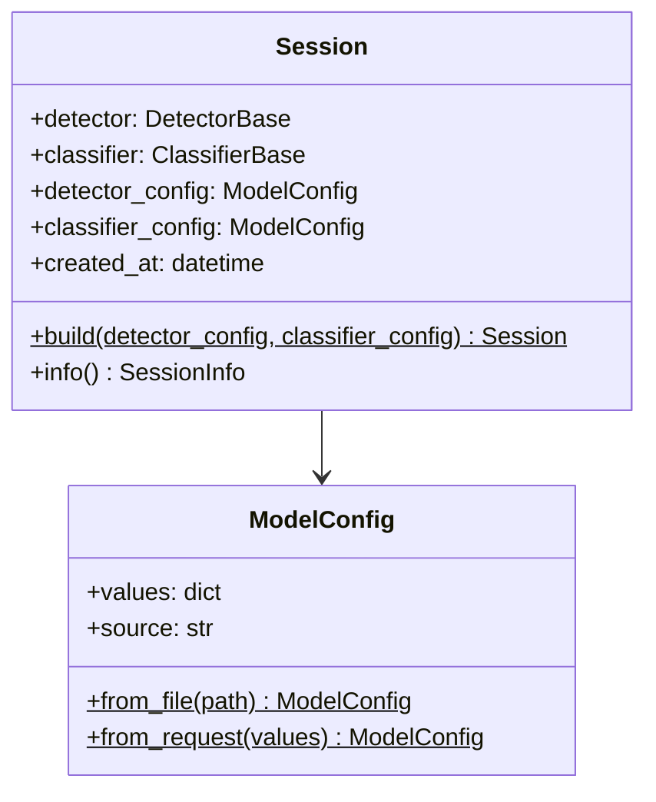

# Plan: session object, model cards and SpeciesNet baseline configs

Stage: PLANNING. No code is changed until this plan is approved. Builds on the model handling on `add_model_class`
(models, `load_model`, services, `ImageResult.error`).

## 1. Requirements

S1. A **session** holds the running detector and classifier instances and their configs. It is built on the first request that needs it and replaces the per-process `functools.cache` in `services/detection.py` / `services/classification.py`.

S2. `POST /api/v1/session` builds a new session and replaces the current one. Its body may carry **complete model configs**
    (the same keys as the YAML files, including `hf_repo` / `hf_filename` / `hf_revision`), so the client can switch to models from
    the Hugging Face Hub without files on the server. A role without a config in the body is built from its env setting. The new
    session is fully built before it replaces the old one, so a failed build leaves the old session running.

S3. `GET /api/v1/session` returns the **model cards** of the running models (building the session first if there is none).

S4. Small response schemas for the session and its model cards (3.3).

S5. No lock: the service runs on one server with a single client that sends requests one at a time (decided by the user).

S6. Baseline configs ship with the repo: SpeciesNet v4.0.3b for detection and cropping, SpeciesNet v4.0.3a (crop classifier) for classifying the crops.

S7. `Taxon.genus` becomes optional, so family/order-level labels (and labels without taxonomy) can be returned.

S8. Unchanged: `POST /api/v1/analyze` and its request/response schemas (apart from S7), the coding guidelines
    (`rodent_experiments/CLAUDE.md`), TDD with review stages.

## 2. Findings

- SpeciesNet versions: the cameratrapai README and SDK 5.0.6 (`speciesnet.SUPPORTED_MODELS`) name only v4.0.3a (`always_crop`,
  the crop classifier) and v4.0.3b (`full_image`, the whole-image classifier). Both bundle MegaDetector v5a and are in the local Kaggle
  cache.
- SDK classifier: `speciesnet.classifier.SpeciesNetClassifier(model_name, device="cpu")`. `preprocess(img, bboxes)` crops each box
  (`always_crop`) and resizes to 480×480; `predict(filepath, preprocessed, num_classes=None)` returns softmax scores for all labels
  (`filepath` is only echoed). The SDK takes a `device` argument, so no attribute patching is needed.
- Labels (2498, file `*.labels.*.txt`): `uuid;class;order;family;genus;species;common name`. 147 labels stop at family or order
  (no genus, e.g. `sciuridae family`); `blank` and `vehicle` have no taxonomy at all.
- SpeciesNet's full prediction also applies geofencing and taxonomic rollup (ensemble). The baseline uses the raw classifier only.
- Model configs already resolve weights from a local path or the HF Hub (`resolve_weights`). An uploaded config therefore chooses what
  the server downloads and unpickles (`weights_only=False` runs code from the pickle). Acceptable for the single trusted client (S5);
  the session endpoint must not be exposed beyond it. Documented in the README.

## 3. Design

### 3.1 Session (`src/ml_pipeline/services/session.py`)



- `ModelConfig` is the parsed config mapping plus where it came from: `from_file(path)` reads YAML (`source` = the path),
  `from_request(values)` takes an uploaded mapping (`source` = `"request"`).
- `Session` is a frozen dataclass. `Session.build(detector_config, classifier_config)` builds both models (`build_model`) and checks
  their kinds (`TypeError` for a classifier config as detector or vice versa, as now).
- `model.py`: `load_model(path)` is split into `read_config(path) -> dict` and `build_model(config) -> ModelBase`;
  `load_model` stays as `build_model(read_config(path))`.
- `model.py`: every model gets a `weights: str` attribute naming its weights (the `model_path` as given, or
  `hf:<repo>/<filename>` plus `@<revision>` when a revision is set). `resolve_weights` wraps download failures of `hf_hub_download`
  (all `OSError` subclasses, like a missing local file) in a new `WeightsDownloadError` (not an `OSError`), so the API can tell a
  failed download (502) from a config error (422).
- Where it lives: `app.state.session` (no module-level variable), set to `None` when the app is created in `main.py`.
- `created_at` is a timezone-aware UTC timestamp.

### 3.2 API (`src/ml_pipeline/api/routes.py`)

| Endpoint | Body | Does | Returns |
|---|---|---|---|
| `POST /api/v1/analyze` | unchanged | uses the current session (built if none) | unchanged |
| `GET /api/v1/session` | — | builds the session if none | `SessionInfo` |
| `POST /api/v1/session` | `SessionRequest` (optional) | builds a new session, then replaces the current one | `SessionInfo` |

- A dependency `get_session(request) -> Session` returns `app.state.session`, building it from the env settings on first use.
- `SessionRequest {detector: dict | None, classifier: dict | None}`: each given mapping is a complete model config (JSON with the
  YAML keys, including `type`); a role that is omitted is built from `DETECTOR_CONFIG` / `CLASSIFIER_CONFIG`. No body = rebuild both
  from the env settings (e.g. after editing the config files).
- Errors:
  - `POST /session` with an invalid config (unknown `type`, missing/unknown keys, invalid values, missing local weights, wrong model
    kind, unset env setting for an omitted role): **422** with the message; the old session stays.
  - `POST /session` whose weights cannot be downloaded from the HF Hub: **502** with the message; the old session stays.
  - Lazy build on `GET /session` or `/analyze` without a configured model (env unset) or with a bad config file: **503** with the
    message. The next request tries again.
- `services/analysis.py`: `analyze_images(image_paths, session)`; `detect_animals(detector, image)` and
  `classify_species(classifier, crop)` take their model as an argument. `detection_model()` / `classification_model()` and both
  `functools.cache` builders are removed. Each result reports `session.detector.info` / `session.classifier.info`, as now.

### 3.3 Schemas (`src/ml_pipeline/schemas/session.py`)

```python
class ModelCard(BaseModel):  # fields every card has
    model_config = ConfigDict(extra="forbid")

    type: str  # model class, e.g. "SpeciesnetDetector"
    info: ModelInfo
    source: str  # config file path, or "request"
    conf_limit: float
    weights: str  # model_path, or "hf:<repo>/<filename>@<revision>"


class DetectorCard(ModelCard):
    role: Literal["detector"]
    labels: list[str]  # labels as returned (label_map applied)


class ClassifierCard(ModelCard):
    role: Literal["classifier"]
    num_classes: int


class SessionInfo(BaseModel):
    created_at: datetime
    # detector first, then classifier; `role` decides the card type
    models: list[Annotated[DetectorCard | ClassifierCard, Field(discriminator="role")]]


class SessionRequest(BaseModel):
    model_config = ConfigDict(extra="forbid")  # a misspelled role is a 422, not a silent rebuild from env

    detector: dict[str, Any] | None = None
    classifier: dict[str, Any] | None = None
```

`Taxon.genus` becomes `str | None = None` (S7); `Taxon` keeps `extra="forbid"`, `Classification` is unchanged otherwise.

### 3.4 `SpeciesnetClassifier` (`model.py`)

- `ClassifierBase` subclass wrapping the SDK classifier, built with `device="cpu"`. `model_path` defaults to
  `kaggle:google/speciesnet/pyTorch/v4.0.3a/1`; `hf_repo` → `NotImplementedError`; `preprocessing` must be empty (the SDK
  preprocesses); the model must be an `always_crop` model (`ValueError` for `full_image`, which expects whole images).
- `predict(crop)`: `preprocess(crop, bboxes=[the whole crop])` → `predict(placeholder, ..., num_classes=None)` → scores reordered into
  label-index order (the probability vector) → `_make_classifications`.
- Taxonomy comes from the model's label file, not from the config: `classes` is not a config key for this class. Mapping:
  `class_name`, `order`, `family`, `genus`, `species`, `common_name` from the label (empty fields → `None`), `kingdom` / `phylum` `None`.
- Crops differ from SpeciesNet's own crops by at most a pixel per side (our crop is widened outward to whole pixels; the SDK truncates).

### 3.5 Baseline configs (`configs/`)

- `configs/speciesnet_detector.yaml`: `type: SpeciesnetDetector`, `model_path: kaggle:google/speciesnet/pyTorch/v4.0.3b/1`,
  `conf_limit: 0.1`, `preprocessing: {}`, `info` (name `speciesnet-detector`, version `v4.0.3b`, MegaDetector v5a).
- `configs/speciesnet_classifier.yaml`: `type: SpeciesnetClassifier`, `model_path: kaggle:google/speciesnet/pyTorch/v4.0.3a/1`,
  `conf_limit: 0.05`, `preprocessing: {}`, `info` (name `speciesnet-classifier`, version `v4.0.3a`, raw classifier, no geofencing/rollup).
- `.env.example` points `DETECTOR_CONFIG` / `CLASSIFIER_CONFIG` at these files (relative paths resolve against the server's working
  directory).
- Configs are ephemeral and get no tests of their own (guidelines); the opt-in integration test loads them.

### 3.6 README
- Document `GET` / `POST /api/v1/session`, the request body (complete configs, HF Hub weights), the model card fields, the 422/502/503
  cases, the shipped baseline configs, that the SpeciesNet baseline is the raw classifier (no geofencing/rollup), that `genus` may be
  `null`, and that the session endpoint must only be reachable by the trusted client (uploaded configs choose what is unpickled).

## 4. Test plan (TDD)

- `tests/test_session.py` (tiny torch models, as now):
  - `Session.build` holds both models, both `ModelConfig`s and `created_at`; swapped configs → `TypeError`; `info()` returns one card
    per model with the right role, type, info, source, `conf_limit`, weights, labels (after `label_map`) / `num_classes`.
  - `ModelConfig.from_file` / `from_request` keep the values and the source.
- `tests/test_model.py`: `read_config` / `build_model` / `load_model` round trip; SpeciesNet classifier with an SDK stub: taxonomy
  mapping from labels (incl. a family-level label and `blank`); probability vector in label order; sorted classifications ≥
  `conf_limit`; placeholder filepath; whole-crop bbox passed to `preprocess`; `device="cpu"`; default `model_path`; `hf_repo` →
  `NotImplementedError`; non-empty preprocessing, `classes` key, `full_image` model → errors.
- `tests/test_main.py`:
  - first `GET /session` builds the session from the env settings; a second `GET` returns the same `created_at`;
  - `POST /session` without body re-reads both env config files (edits since the last session show up);
  - `POST /session` with an uploaded config switches that model (its card changes) and builds the other from env;
  - `POST /session` with an uploaded HF config downloads through `hf_hub_download` (stubbed) and the card shows the HF weights;
  - invalid uploaded config, swapped kinds, missing local weights → 422; failing HF download (stub raises) → 502; in both cases
    `GET` still shows the old session;
  - `GET /session` / `/analyze` with unset env → 503 naming the variable; after setting it, the next request succeeds;
  - `/analyze` uses the current session's models (results change after a `POST /session` with another config).
- `tests/test_detection.py`: the existing service tests, now passing models / a session explicitly (no cache clearing).
- `tests/test_schemas.py`: `Taxon` with `genus=None`; `DetectorCard` requires `labels`, `ClassifierCard` requires `num_classes`,
  neither accepts the other's field or a wrong `role`; `SessionInfo` parses each card into its type by `role`; JSON shape.
- Opt-in integration (`RUN_SPECIESNET_INTEGRATION=1`): with the shipped configs, `/analyze` on `tests/data/rodent.jpg` gives an
  `animal` detection whose classifications include one with order `rodentia`.

## 5. Out of scope

- Locking or concurrent sessions (S5); persisting sessions across restarts; authentication of the session endpoint.
- Fetching config files themselves from the HF Hub (configs are sent in the request body).
- Geofencing, taxonomic rollup and the SpeciesNet ensemble.
- Our own rodent classifier config (replaces the SpeciesNet classifier later).
- Batching, GPU, Docker image.

## 6. Implementation order (after approval)

1. Tests stage → review agent (up to 4 rounds) → your review.
2. Implementation stage → review agent (up to 4 rounds) → your review.
3. Refactoring stage → review agent (up to 4 rounds) → your review.
